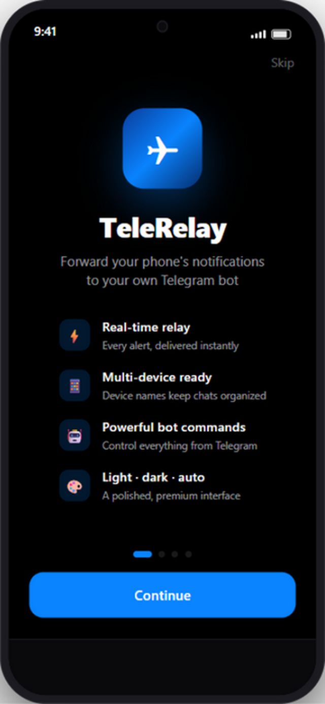
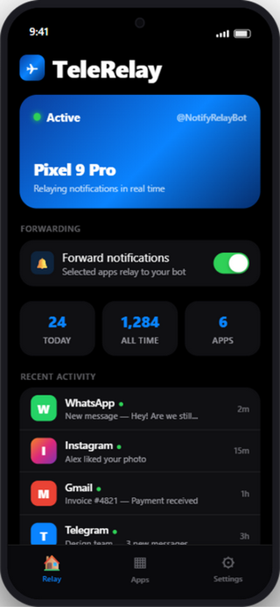
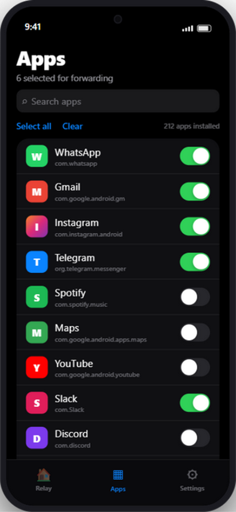
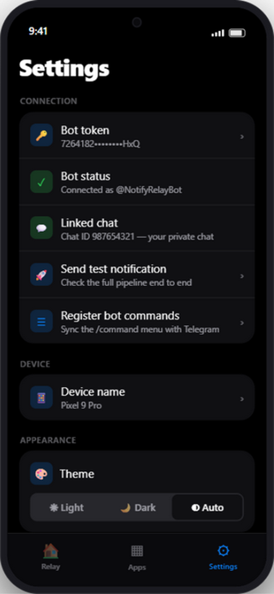
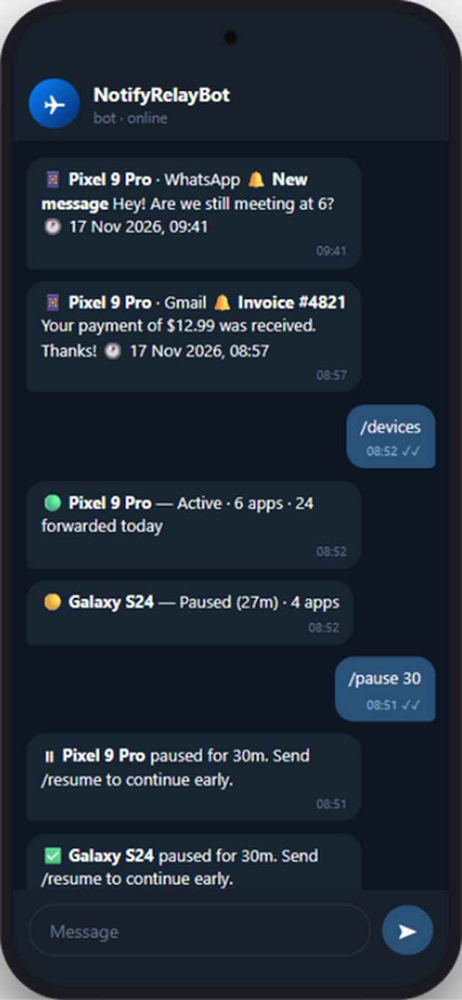
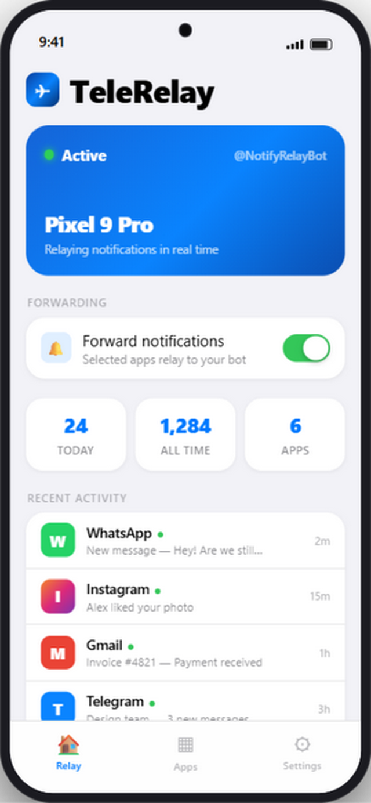

<p align="center">
  
</p>

<h1 align="center">TeleRelay</h1>

<p align="center">
  <b>Forward Android notifications to your own Telegram bot — beautifully.</b><br>
  Pick your apps, name your devices, and every notification lands in your Telegram chat with a premium, polished experience.
</p>

<p align="center">
  
  
  
  
  
</p>

---

## ✨ Features

- 🔔 **Notification forwarding** — relay notifications from the exact apps you choose straight to your private Telegram bot chat
- 📱 **Multi-device ready** — every message starts with the device name, so you always know *which phone* sent it
- 🤖 **Powerful bot commands** — check devices, list apps, search history, pause/resume, mute apps… all from Telegram
- 🔐 **Owner-only bot** — the bot replies exclusively to the chat that sends `/start`; nobody else can use it
- 🎨 **Light · Dark · Auto themes** — a true-black AMOLED-friendly dark mode and a clean light mode, following your system automatically
- 📲 **iOS-inspired design language** — grouped cards, springy animations, soft press effects, and haptic feedback everywhere
- 🚀 **Lightweight & private** — no accounts, no servers, no tracking. Your bot token stays on your phone

## 📸 Screenshots

| | | |
|:---:|:---:|:---:|
|  |  |  |
|  |  |  |

## ⚙️ Setup

### 1. Create your Telegram bot (1 minute)

1. Open Telegram and message [@BotFather](https://t.me/BotFather)
2. Send `/newbot` and follow the prompts
3. Copy the bot token (looks like `123456789:AAE…`)

### 2. Set up the app

1. Download the latest APK from [**Releases**](../../releases) and install it
   (allow *install from unknown sources* if prompted)
2. **Onboarding** walks you through everything:
   - Paste the **bot token** (it's verified instantly against `getMe`)
   - Set a **device name** (e.g. *Pixel 9 Pro*, *Galaxy S24*)
   - Grant **notification access** in system settings
3. In Telegram, send `/start` to your bot — this links your chat as the owner
4. Open the **Apps** tab and toggle on the apps you want forwarded

That's it — notifications now land in your Telegram chat:

```
📱 Pixel 9 Pro · WhatsApp
🔔 New message

Hey! Are we still meeting at 6?

🕐 17 Nov 2026, 09:41
```

> 💡 Install TeleRelay on several phones with the **same bot token** and different device names — all of them relay into one chat, clearly labeled.

## 🤖 Bot Commands

Send `/help` to your bot anytime. All commands work from your linked chat only.

| Command | Description |
|---|---|
| `/start` | Link this chat as the owner |
| `/help` | Show everything the bot can do |
| `/devices` | Status of every connected device |
| `/apps` | Apps this device forwards |
| `/recent` `[app]` | Last forwarded notifications |
| `/search` `<text>` | Search forwarded notifications |
| `/pause` `[minutes]` | Pause forwarding on all devices |
| `/resume` | Resume forwarding everywhere |
| `/mute` `<app>` | Stop forwarding an app |
| `/unmute` `<app>` | Resume forwarding an app |
| `/test` | Send a test notification |
| `/ping` | Check whether the device is alive |
| `/id` | Show this chat's ID |

## 🛠 Build from Source

Requirements: **Android Studio** (or JDK 17+ with the Android SDK), minimum API 26.

```bash
git clone https://github.com/Shishir-ip/Telegram-Notification-Forwarder.git
cd Telegram-Notification-Forwarder
./gradlew :app:assembleDebug      # debug APK
./gradlew :app:assembleRelease    # release APK (needs signing config)
```

**Release signing:** TeleRelay reads signing credentials from `keystore.properties` (git-ignored):

```properties
storeFile=telerelay-release.keystore
storePassword=your_password
keyAlias=telerelay
keyPassword=your_password
```

Create your own keystore:

```bash
keytool -genkeypair -v -keystore my-release.keystore -alias telerelay \
  -keyalg RSA -keysize 2048 -validity 10000
```

> ⚠️ **Back up your keystore.** Android updates are only accepted when signed with the same key — losing it means users must reinstall.

## ❓ Troubleshooting

| Problem | Fix |
|---|---|
| No notifications arriving | Check notification access (Settings → Apps → Special access → Notification access), make sure forwarding is on and the app is selected |
| Bot doesn't reply to commands | Send `/start` from your private chat first; make sure only TeleRelay devices poll this token (a set webhook breaks polling — TeleRelay removes it automatically) |
| `409 Conflict` errors | Another getUpdates consumer (webhook or script) is using the same bot token |
| Duplicate device replies | Expected when several phones share one token — each answers for itself |

## 🧱 Tech Stack

- **Kotlin** + **Jetpack Compose** (Material 3), hand-rolled iOS-style component kit
- `NotificationListenerService` for reliable notification capture
- Telegram Bot API over OkHttp — offset-free polling so multiple devices share one token safely
- Foreground service (data-sync) for low-latency command handling, boot receiver for auto-restart

## 📜 License

[MIT](LICENSE) — free to use, modify, and distribute.

<p align="center">
  <i>Made with ⚡ for people who live in Telegram</i>
</p>

<details>
<summary>🔍 SEO keywords</summary>
telegram notification forwarder, android notification to telegram, notification mirror app, telegram bot notifications, forward sms to telegram, notification relay android, multi-device notification forwarder, jetpack compose telegram, notification listener app, tele relay
</details>
